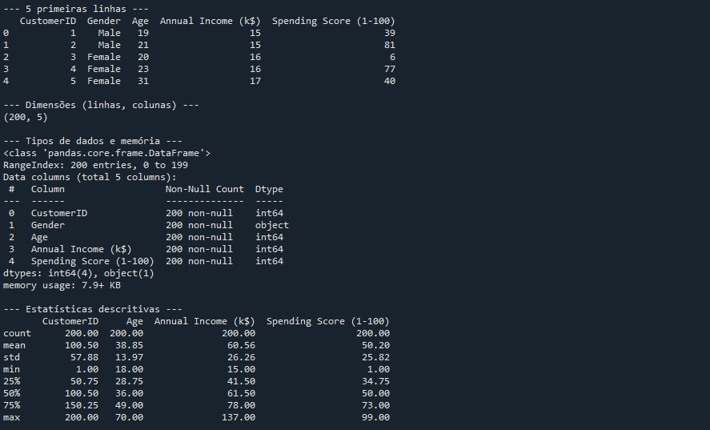
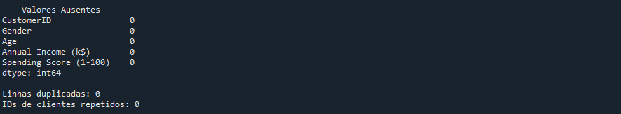
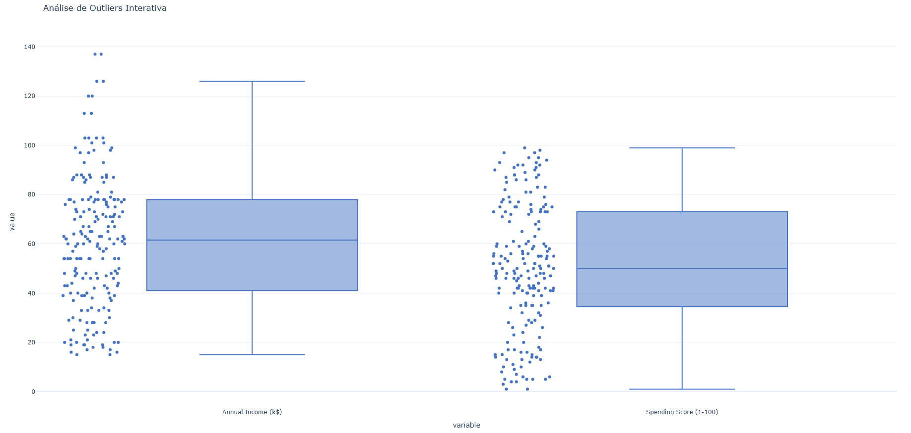
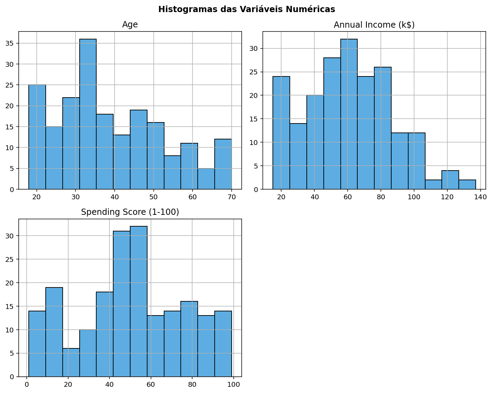
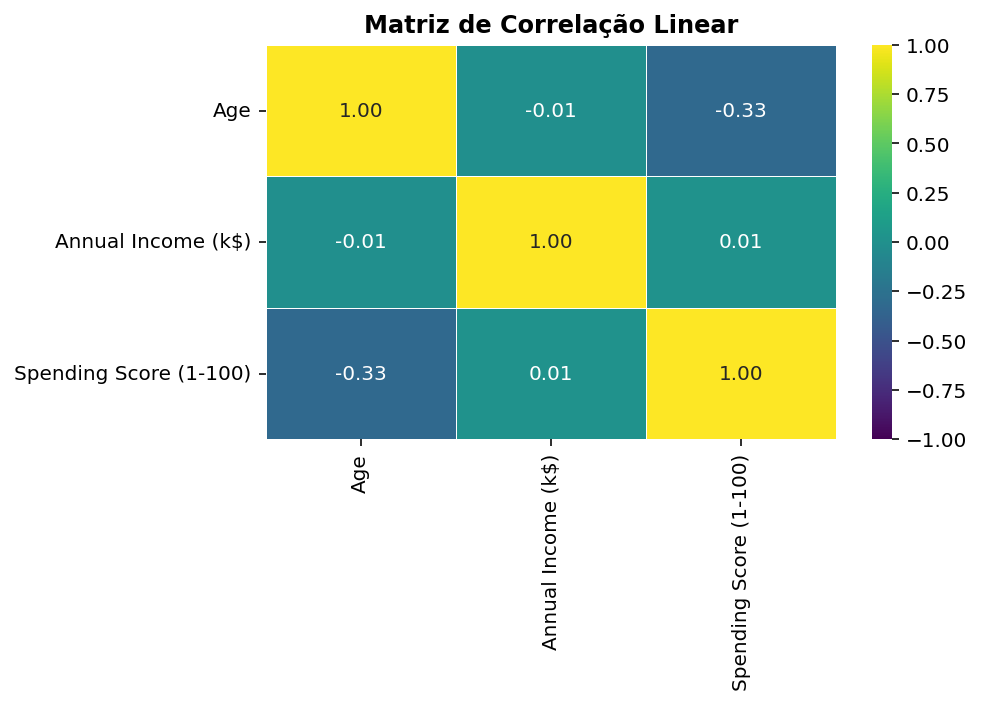
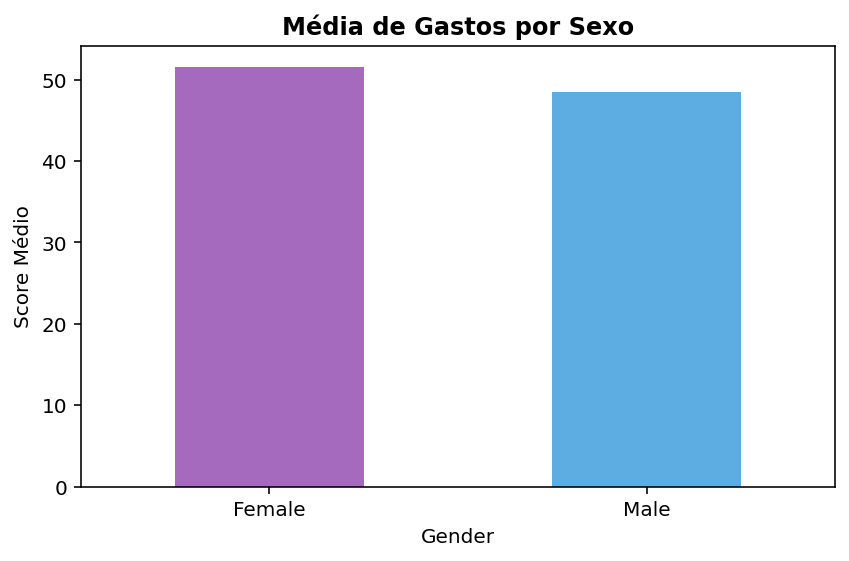
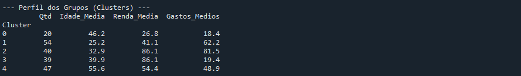
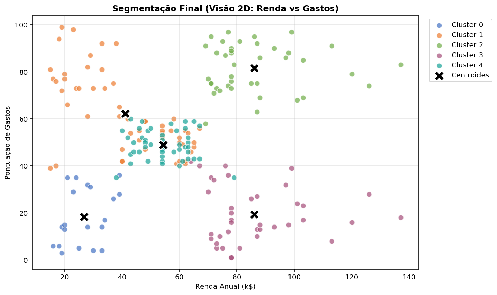

# Segmentação de Clientes de Shopping (Mall Customers)

Neste repositório, compartilho um projeto completo de Análise Exploratória de Dados (EDA) e Aprendizado de Máquina Não Supervisionado. Utilizei uma base de dados real de clientes de um shopping para segmentá-los em grupos (clusters) estratégicos com base na idade, renda anual e pontuação de gastos. 

Esse tipo de análise é o núcleo do trabalho de ciência de dados voltado para negócios, sendo fundamental para equipes de marketing criarem campanhas direcionadas e personalizadas, maximizando o ROI (Retorno sobre Investimento).

## 🛠️ Tecnologias Utilizadas

Todo o desenvolvimento foi construído em **Python** (otimizado para o ambiente interativo Spyder), utilizando as principais ferramentas do ecossistema de dados:

* **Pandas & NumPy:** Para manipulação, limpeza e transformação dos dados tabulares.
* **Matplotlib & Seaborn:** Para a criação de visualizações estáticas, análises de distribuição e identificação de *outliers*.
* **Plotly:** Para a construção de gráficos interativos (em 2D e 3D), permitindo uma análise mais profunda e dinâmica dos perfis.
* **Scikit-Learn:** Para a padronização das *features* matemáticas (`StandardScaler`) e modelagem de agrupamento (`KMeans`).

## 📦 Como Instalar as Dependências

Para rodar este projeto na sua máquina de forma limpa e sem erros de versão, preparei um arquivo `requirements.txt` com todas as bibliotecas necessárias.

**Passo a passo da instalação:**

1. Faça o download ou clone este repositório para o seu computador.
2. Abra o terminal (ou Prompt de Comando/PowerShell) na pasta onde os arquivos foram salvos.
3. Execute o comando abaixo para instalar tudo de uma só vez:

   ```bash
   pip install -r requirements.txt
   ```

## 🚀 Como Executar o Projeto

1. Certifique-se de que os arquivos `ProjetoFinal.py`, `mall_customers.csv` e `requirements.txt` estão no mesmo diretório.
2. Abra o arquivo `ProjetoFinal.py` na sua IDE favorita (recomendo o **Spyder** ou o **VS Code** com a extensão do Jupyter).
3. Execute as células de código sequencialmente (os blocos separados por `# %%`).
4. Os gráficos em HTML (como a visualização 3D) serão salvos automaticamente na pasta do projeto. Basta dar um duplo clique para abri-los no seu navegador!

---

## 📂 O que você vai encontrar no código (Passo a Passo)

Para facilitar a leitura e a manutenção, dividi o script em 14 blocos lógicos. Abaixo, explico o objetivo de cada etapa e os *insights* de negócio extraídos:

### 1. Preparando o Terreno (Importações)
* **O que faz:** Importa todas as bibliotecas necessárias e configura as variáveis de ambiente (como `OMP_NUM_THREADS="1"`) para evitar alertas de conflitos de memória e processamento interno do Scikit-Learn durante a clusterização.

### 2. Leitura Dinâmica dos Dados
* **O que faz:** Captura o diretório atual do script e carrega o arquivo `mall_customers.csv` em um *DataFrame* do Pandas. O uso de caminhos relativos garante que o código rode perfeitamente no seu computador sem precisar alterar o caminho do arquivo manualmente.

### 3. Inspeção Inicial da Estrutura
* **O que faz:** Exibe as primeiras linhas, os tipos de dados de cada coluna e um resumo estatístico (`describe`).
* **O que observamos:** A base possui informações claras: ID do cliente, gênero, idade, renda anual (em milhares de dólares) e uma pontuação de gastos de 1 a 100 estabelecida pelo shopping.


### 4. Checagem de Qualidade e Integridade
* **O que faz:** Procura por valores nulos (dados faltantes) e verifica se há duplicatas (clientes registrados duas vezes).
* **O que observamos:** A base original é extremamente limpa, o que nos permite focar diretamente na extração de valor analítico sem perder tempo com imputação de dados.


### 5. Análise de Outliers (Violino + Stripplot)
* **O que faz:** Substitui o Boxplot tradicional por uma visualização mais rica do Seaborn (Gráfico de Violino sobreposto por um gráfico de dispersão em formato de enxame).
* **O que observamos:** Em vez de ver apenas quartis, conseguimos enxergar a "massa" de clientes. Existem alguns registros de renda na casa dos $130k+, que são valores extremos (*outliers*), mas totalmente válidos para a segmentação de clientes de luxo.


### 6. Análise de Outliers Interativa (Plotly)
* **O que faz:** Gera um arquivo HTML independente com um Boxplot interativo.
* **O que observamos:** Permite passar o mouse e inspecionar ponto a ponto. É uma excelente ferramenta para entregar relatórios interativos para gestores que não sabem programar.


### 7. Distribuição Geral (Histogramas)
* **O que faz:** Plota histogramas das colunas numéricas (Idade, Renda e Gastos).
* **O que observamos:** A faixa etária predominante dos frequentadores é entre 30 e 40 anos, com a maior concentração de renda anual na faixa de 50k a 85k dólares.


### 8. Relação Renda vs. Gastos
* **O que faz:** Cria um gráfico de dispersão (*scatter plot*) bidimensional cruzando Renda e Score de Gastos.
* **O que observamos:** Visualmente, já é possível notar a formação natural de **5 grandes grupos de consumidores**, validando a escolha futura do algoritmo e o número de clusters.
.png?raw=true)

### 9. Matriz de Correlação (Heatmap)
* **O que faz:** Calcula a correlação de Pearson entre as variáveis contínuas e plota um mapa de calor.
* **O que observamos:** As variáveis numéricas têm correlações lineares fracas entre si. Isso prova que o comportamento de compra é complexo e justifica o uso de Machine Learning para encontrar padrões ocultos que uma simples estatística descritiva não pegaria.


### 10. Perfil Demográfico por Gênero
* **O que faz:** Agrupa os dados por sexo e compara as médias.
* **O que observamos:** A proporção de clientes femininas é levemente maior, mas os padrões de renda e gastos são estatisticamente muito similares entre homens e mulheres. O gênero isolado não define o potencial de compra.
.png?raw=true)


### 11. Pré-processamento e Modelagem (K-Means)
* **O que faz:** Isola as variáveis que importam (Idade, Renda, Gastos), aplica o `StandardScaler` (para colocar todas na mesma escala matemática) e treina o modelo K-Means configurado para encontrar 5 clusters ($K=5$). Salva as *labels* geradas de volta na base original.

### 12. Avaliação dos Clusters Criados
* **O que faz:** Faz um agrupamento final exibindo o perfil exato (médias) de quem compõe cada um dos 5 grupos formados pela IA.
* **O que observamos:** O modelo separou os perfis com perfeição estratégica:
  * *Alto potencial:* Alta renda e altos gastos.
  * *Econômicos/Conservadores:* Alta renda e baixos gastos.
  * *Massa (Público Geral):* Renda média e gastos médios.
  * Entre outras variações valiosas para campanhas de marketing.


### 13. Visão 2D da Segmentação (Com Centroides)
* **O que faz:** Reverte a escala padronizada dos centroides (corações dos grupos) para os valores reais em dólares/pontos e os plota em um gráfico de dispersão 2D, marcando o centro com um "X". Facilita a visualização do mapeamento da IA.


### 14. Análise 3D Interativa Final (O Grande Diferencial)
* **O que faz:** Utiliza o Plotly para gerar a segmentação completa cruzando simultaneamente **Idade, Renda e Gastos** em um espaço tridimensional exportado em HTML.
* **O que observamos:** Ao interagir com o gráfico (girando e dando zoom), fica evidente que a Idade afeta diretamente alguns clusters. Por exemplo, podemos observar que clientes com altíssima pontuação de gastos e renda mais baixa costumam ser consideravelmente mais jovens. Essa visualização entrega um mapeamento comportamental completo para o negócio.
%20HTML.png?raw=true)
